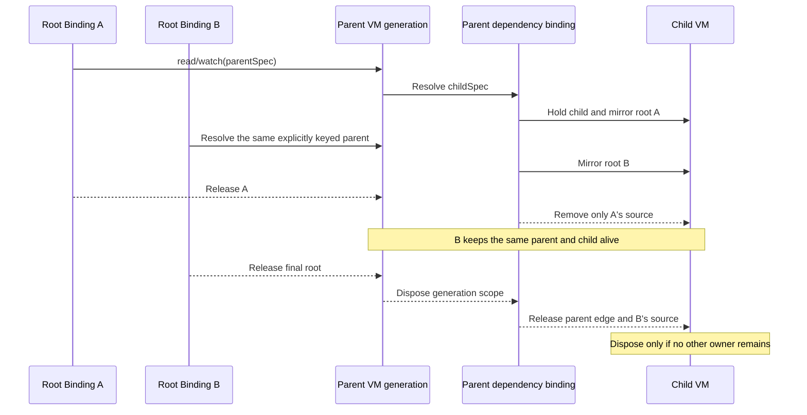

# view_model

[简体中文](https://github.com/lwj1994/flutter_view_model/blob/main/packages/view_model/README_ZH.md) · [pub.dev](https://pub.dev/packages/view_model)

**Install Skill**

```sh
npx skills add https://github.com/lwj1994/flutter_view_model --skill view_model
```

A Flutter architecture library built from first principles: instance identity,
ownership, and notification relationships.

**Everything is ViewModel. Binding manages lifecycle. Flutter adapts rendering.**

A ViewModel is a managed functional module: a service, repository, coordinator,
or page model. Modules compose through the same binding mechanism. Plain data,
value objects, and pure functions can stay as they are.

## Start with three questions

| Question | Responsibility | Rule |
| --- | --- | --- |
| Which instance do I need? | `ViewModelSpec` and its resolved identity | The resolved type `T` plus the effective `key` identifies an instance. |
| Why should it stay alive? | `ViewModelBinding` | A binding owns the instances it resolves; a parent owns its resolved dependencies. |
| Who needs to hear about a change? | Subscriptions | `read` holds an instance; `watch` also subscribes to its notifications. |

These responsibilities give the architecture four invariants:

1. **Independent of `build`.** A binding can call `read` and `watch` from any
   Dart class. The ownership and subscription rules are the same inside and
   outside widgets.
2. **Explicit ownership.** Ordinary instances are disposed when their final
   owner releases them. Sharing an instance does not make it permanent.
3. **Stable subscriptions.** Repeated reads and widget rebuilds do not replace
   existing subscriptions. A later `read` does not undo an earlier `watch`.
4. **Faithful notifications.** Every dependency path can carry business
   notifications, including diamonds. Only root refresh requests are coalesced
   within one synchronous propagation transaction.

The runtime currently depends on the Flutter SDK. Using a binding in an
ordinary Dart class requires neither a widget tree nor a `BuildContext`.

## Use it without a widget

```sh
flutter pub add view_model
```

Define the module, declare how to construct it, and give it an owner:

```dart
import 'package:view_model/view_model.dart';

class CounterViewModel with ViewModel {
  int count = 0;

  void increment() => update(() {
        count += 1;
      });
}

final counterSpec = ViewModelSpec<CounterViewModel>(
  builder: CounterViewModel.new,
);

class CounterScope with ViewModelBinding {
  CounterViewModel get counter => viewModelBinding.read(counterSpec);
}

void main() {
  final scope = CounterScope();
  try {
    scope.counter.increment();
    assert(scope.counter.count == 1);
  } finally {
    scope.dispose();
  }
}
```

The spec declares construction; it does not create an instance. The first
`read` creates the counter. Later reads through the same binding reuse it.
Disposing the scope releases its ownership and disposes this counter.

Use `update` for a mutation followed by notification, or call
`notifyListeners()` explicitly. A synchronous `update` notifies synchronously;
an asynchronous one notifies after successful completion.

<a id="viewmodelbinding---viewmodel-execution-framework"></a>

A plain host can also `watch` and override `onUpdate()` to request a refresh.
Use explicit listeners for business reactions, as described below. Always
call `dispose()` when a plain host's ownership ends.

## Flutter adapts the same binding

Keep `CounterViewModel` and `counterSpec` from above. Add the Flutter import and
replace `main()` with this entry point:

```dart
import 'package:flutter/material.dart';

void main() => runApp(const MaterialApp(home: CounterPage()));

class CounterPage extends StatefulWidget {
  const CounterPage({super.key});

  @override
  State<CounterPage> createState() => _CounterPageState();
}

class _CounterPageState extends State<CounterPage>
    with ViewModelStateMixin<CounterPage> {
  CounterViewModel get counter => viewModelBinding.watch(counterSpec);

  @override
  Widget build(BuildContext context) => Scaffold(
        body: Center(child: Text('${counter.count}')),
        floatingActionButton: FloatingActionButton(
          onPressed: () => counter.increment(),
          child: const Icon(Icons.add),
        ),
      );
}
```

`ViewModelStateMixin` connects binding refresh requests to Flutter and releases
the binding when the `State` is disposed. Business logic stays in the module.
Neither instance ownership nor subscriptions are inferred anew from each
`build`: repeated `watch` calls do not add duplicate subscriptions, and
omitting a `watch` from a later build does not unsubscribe it.

## Compose modules through ownership

A ViewModel has its own `viewModelBinding`. Use it to resolve dependencies:

```dart
class DashboardViewModel with ViewModel {
  CounterViewModel get counter => viewModelBinding.watch(counterSpec);

  String get summary => 'Count: ${counter.count}';
}

final dashboardSpec = ViewModelSpec<DashboardViewModel>(
  builder: DashboardViewModel.new,
);
```

The counter is resolved only when its getter is accessed. `watch` forwards
counter notifications through the dashboard; `read` would retain the counter
without forwarding its state notifications.

Each parent object, from creation to disposal, is one generation. It owns one
stable, lazily created dependency binding. When two roots share an explicitly
keyed parent with automatic disposal:



A root can reach the same child directly and through several parents. Each
path has its own ownership source; releasing one path cannot erase another.
The parent's current roots are mirrored to its resolved children as roots
join or leave. An unkeyed child keeps its identity throughout that parent
generation, including when the root owners change.

Keep dependency access in resolving getters. Pass specs or ordinary data
between owners, so each owner establishes its own binding. Storing a resolved
ViewModel in a `late final` field or passing it to another owner does not
establish that ownership and can leave a stale reference after recycling.

The dependency graph must be acyclic. Diamonds are valid; direct and indirect
cycles are rejected. Builder or constructor failure rolls back tentative
scopes and ownership, preserving existing shared instances.

## Identity is separate from lifetime

Identity is the resolved generic type `T` plus the effective `key`:

| Resolution | Result |
| --- | --- |
| Same `T`, same binding, no explicit key | One instance. |
| Same `T`, different bindings, no explicit key | Separate instances. |
| Same `T`, equal explicit keys | One shared instance while it remains alive. |
| Different `T`, equal explicit keys | Separate instances. |

A spec object, constructor arguments, the builder's runtime result type, and
`tag` do not independently define identity. Cache hits do not run the builder
again. Each parent generation is a separate binding scope, so using the same
unkeyed spec in two parents does not share a child.

To share the counter between independent owners, give its spec an explicit
key:

```dart
final sharedCounterSpec = ViewModelSpec<CounterViewModel>(
  builder: CounterViewModel.new,
  key: 'shared-counter',
);
```

Every owner resolves `sharedCounterSpec` through its own `read` or `watch`.
The counter remains alive until the last owner leaves. For parameterized
specs, include the entity's identity in the key; different arguments with an
unchanged key reuse the first-created instance.

## Ownership and subscriptions are independent

| API | Creates when absent | Holds ownership | Observes VM notifications | Observes disposal / recycle |
| --- | --- | --- | --- | --- |
| `read(spec)` | Yes | Yes | No | Yes |
| `watch(spec)` | Yes | Yes | Yes | Yes |

Both calls retain the instance. Within one binding, repeated resolution of the
same instance does not add owners. A `watch` subscription stays active until
its binding or instance is disposed, even if later access uses `read`.
Resolving a different key adds another owned instance; it does not release
previously resolved keys.

Business reactions use `listen`, `listenState`, or `listenStateSelect`.
Register them once during initialization, not in a getter or `build`.
Binding-owned listeners are cleaned up with the binding.

In a diamond, a change can reach the same parent along two dependency paths.
Both paths must be delivered: business listeners can see intermediate values
and the later value. A synchronous propagation transaction coalesces root
`onUpdate` refresh requests, not business notifications. `onUpdate` requests a
refresh at the first event; it is not an end-of-transaction business callback.
Microtask and `Future` notifications start new transactions. Reentrant state
transitions are delivered in transition order.

## Lifecycle boundaries

- Ordinary instances use automatic disposal. Register owned resources with
  `addDispose`, for example `addDispose(subscription.cancel)`.
- Hooks are `onCreate`, `onBind`, `onUnbind`, and `onDispose`. For each binding
  ID, its first ownership source triggers `onBind`; its last triggers
  `onUnbind`.
- `aliveForever: true` explicitly retains an instance with zero external
  owners and requires an explicit key. A retained parent also retains its
  resolved children. A key alone does not do this.
- `recycle(vm)` forcibly disposes that generation for **all owners**. The next
  getter-based resolution can create a new generation and dependency scope.
  `ViewModel.reset()` clears the whole runtime, including retained instances.

These are lifetime controls. Normal module composition needs only a spec and
an owning binding.

## Test through the same boundary

Reuse `CounterScope` from the example in a Flutter test file:

```dart
import 'package:flutter_test/flutter_test.dart';

void main() {
  test('the scope reuses its counter', () {
    final scope = CounterScope();
    addTearDown(scope.dispose);

    scope.counter.increment();

    expect(scope.counter.count, 1);
  });
}
```

Construct ViewModels inside spec builders and resolve them through the test
binding. No widget is needed. Run tests serially because runtime registry and
configuration are process-global:

```sh
flutter test --concurrency=1
```

## Reference

- [Architecture guide](https://github.com/lwj1994/flutter_view_model/blob/main/packages/view_model/ARCHITECTURE_GUIDE.md): ownership paths, construction, rollback, and lifecycle contracts.
- [API reference](https://pub.dev/documentation/view_model/latest/): state models, explicit listeners, selectors, and adapter APIs.
- [Examples](https://github.com/lwj1994/flutter_view_model/tree/main/example): runnable Flutter applications.
- [Module composition example](https://github.com/lwj1994/flutter_view_model/tree/main/.agents/skills/view_model/examples/instagram_architecture): services, repositories, and page modules in one dependency graph.
- [Optional spec generation](https://github.com/lwj1994/flutter_view_model/blob/main/packages/view_model_generator/README.md): generate construction declarations without changing ownership rules.

<details>
<summary>Advanced cached lookup semantics</summary>

Normal dependencies use `read(spec)` or `watch(spec)`. Cached APIs only query
instances already created by another path. Every hit establishes ownership;
no cached API can construct a missing dependency. The `maybe` variants return
`null` on a miss; tag batches return all matches.

| API | Creates | Holds ownership on a hit | Observes VM notifications | Observes disposal / recycle |
| --- | --- | --- | --- | --- |
| `readCached(key/tag)` | No | Yes | No | Yes |
| `watchCached(key/tag)` | No | Yes | Yes | Yes |
| `maybeReadCached(key/tag)` | No | Yes | No | Yes |
| `maybeWatchCached(key/tag)` | No | Yes | Yes | Yes |
| `readCachesByTag(tag)` | No | Yes | No | Yes |
| `watchCachesByTag(tag)` | No | Yes | Yes | Yes |

</details>
