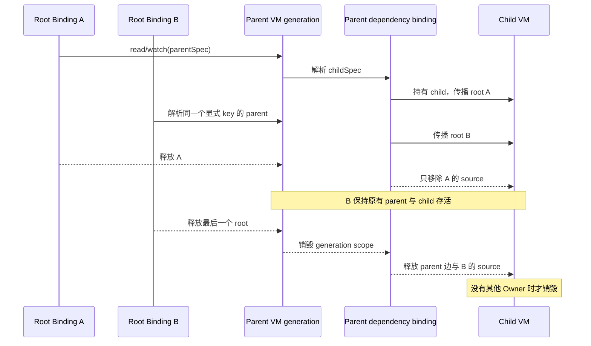

# view_model

[English](https://github.com/lwj1994/flutter_view_model/blob/main/packages/view_model/README.md) · [pub.dev](https://pub.dev/packages/view_model)

**安装 Skill**

```sh
npx skills add https://github.com/lwj1994/flutter_view_model --skill view_model
```

一个从第一性原理出发的 Flutter 架构库：明确实例身份、所有权和通知关系。

**Everything is ViewModel，Binding 管理生命周期，Flutter 只负责渲染适配。**

ViewModel 是受管理的功能模块，可以是服务、仓库、协调器，也可以是页面模型。模块之间通过同一种 Binding 机制组合。普通数据、值对象和纯函数保持原样即可。

## 从三个问题开始

| 问题 | 由谁负责 | 规则 |
| --- | --- | --- |
| 我要哪个实例？ | `ViewModelSpec` 与解析后的身份 | 解析使用的类型 `T` 与有效 `key` 共同确定实例。 |
| 它为什么还活着？ | `ViewModelBinding` | Binding 持有解析到的实例，parent 持有已解析的依赖。 |
| 变化应该通知谁？ | 订阅关系 | `read` 持有实例，`watch` 在持有之外订阅通知。 |

由此确定四个不变量：

1. **与 `build` 无关。** 任意 Dart 类都可以通过 Binding 调用 `read/watch`，Widget 内外遵守相同的所有权和订阅规则。
2. **所有权明确。** 普通实例在最后一个 Owner 释放后自动销毁。共享实例不会让它永久存活。
3. **订阅独立。** 重新读取、Widget 重建都不替换已有订阅。后续 `read` 不会撤销之前的 `watch`。
4. **通知准确。** 业务通知沿每条依赖路径传递，菱形依赖也不例外。同一轮同步传播只合并 root 的刷新请求。

当前运行时仍依赖 Flutter SDK。在普通 Dart 类中使用 Binding，不需要 Widget 树或 `BuildContext`。

## 从普通类开始

```sh
flutter pub add view_model
```

定义模块，声明创建方式，再为它提供一个 Owner：

```dart
import 'package:view_model/view_model.dart';

class CounterViewModel with ViewModel {
  int count = 0;

  void increment() => update(() {
        count += 1;
      });
}

final counterSpec = ViewModelSpec<CounterViewModel>(
  builder: CounterViewModel.new,
);

class CounterScope with ViewModelBinding {
  CounterViewModel get counter => viewModelBinding.read(counterSpec);
}

void main() {
  final scope = CounterScope();
  try {
    scope.counter.increment();
    assert(scope.counter.count == 1);
  } finally {
    scope.dispose();
  }
}
```

Spec 只声明如何创建实例。第一次 `read` 创建 counter，同一 Binding 后续读取复用它。Scope 销毁时释放所有权，这个 counter 随之销毁。

通过 `update` 修改数据并通知，也可以显式调用 `notifyListeners()`。同步 `update` 同步通知；异步 `update` 在成功完成后通知。

普通 host 同样可以 `watch`，并通过覆写 `onUpdate()` 请求刷新。业务响应使用下文的显式监听。普通 host 的所有权结束时，需要主动调用 `dispose()`。

## Flutter 适配同一个 Binding

保留上面的 `CounterViewModel` 与 `counterSpec`，添加 Flutter import，并替换 `main()`：

```dart
import 'package:flutter/material.dart';

void main() => runApp(const MaterialApp(home: CounterPage()));

class CounterPage extends StatefulWidget {
  const CounterPage({super.key});

  @override
  State<CounterPage> createState() => _CounterPageState();
}

class _CounterPageState extends State<CounterPage>
    with ViewModelStateMixin<CounterPage> {
  CounterViewModel get counter => viewModelBinding.watch(counterSpec);

  @override
  Widget build(BuildContext context) => Scaffold(
        body: Center(child: Text('${counter.count}')),
        floatingActionButton: FloatingActionButton(
          onPressed: () => counter.increment(),
          child: const Icon(Icons.add),
        ),
      );
}
```

`ViewModelStateMixin` 把 Binding 的刷新请求接到 Flutter，在 `State` 销毁时释放 Binding。业务逻辑留在模块中。

每次 `build` 不会重新决定实例归属或订阅关系：重复 `watch` 不会增加重复订阅，后续某次 build 没有调用 `watch` 也不会自动取消订阅。

## 通过所有权组合模块

ViewModel 自带 `viewModelBinding`，用它解析依赖：

```dart
class DashboardViewModel with ViewModel {
  CounterViewModel get counter => viewModelBinding.watch(counterSpec);

  String get summary => 'Count: ${counter.count}';
}

final dashboardSpec = ViewModelSpec<DashboardViewModel>(
  builder: DashboardViewModel.new,
);
```

Getter 被访问时才解析 counter。这里的 `watch` 让 counter 通知继续传递到 dashboard；改成 `read` 则只持有 counter，不转发它的状态通知。

每个 parent 对象从创建到销毁是一个 generation。它按需拥有一个稳定的内部 dependency binding。两个 root 通过显式 key 共享一个自动销毁的 parent 时：



同一个 root 可以直接持有 child，也可以通过多个 parent 持有它。每条路径独立记录所有权来源，释放一条路径不会误删另一条。Parent 的 root 增减会实时传播到已解析的 child。无显式 key 的 child 在整个 parent generation 内保持身份稳定，root 切换也不例外。

依赖通过 getter 重新解析。跨 Owner 传递 spec 或普通数据，由接收方建立自己的 Binding 归属。把已解析的 ViewModel 存入 `late final`，或直接交给另一个 Owner，都不能代替所有权绑定，还可能在 recycle 后留下旧对象引用。

依赖图必须无环。菱形合法，直接或间接循环会被拒绝。Builder 或构造函数失败时，暂存的 scope 和所有权会回滚，已有共享实例不受影响。

## 身份与生命周期分开

实例身份是解析使用的泛型类型 `T` 加有效 `key`：

| 解析方式 | 结果 |
| --- | --- |
| 同一 `T`、同一 Binding、无显式 key | 一个实例。 |
| 同一 `T`、不同 Binding、无显式 key | 各自独立。 |
| 同一 `T`、相等的显式 key | 实例存活期间共享。 |
| 不同 `T`、相等的显式 key | 各自独立。 |

Spec 对象、构造参数、builder 返回对象的运行时类型和 `tag` 都不会单独决定身份。命中缓存时不会再次执行 builder。每个 parent generation 有独立的 Binding scope，因此两个 parent 使用同一个无 key 的 spec，不会共享 child。

如果独立 Owner 需要共享 counter，为 spec 设置显式 key：

```dart
final sharedCounterSpec = ViewModelSpec<CounterViewModel>(
  builder: CounterViewModel.new,
  key: 'shared-counter',
);
```

每个 Owner 都通过自己的 `read/watch` 解析 `sharedCounterSpec`。最后一个 Owner 离开后，counter 自动销毁。带参数的 spec 应把区分实体的参数纳入 key；参数变化但 key 不变，仍复用最先创建的实例。

## 持有与订阅分开

| API | 不存在时创建 | 持有实例 | 监听 VM 通知 | 感知销毁 / recycle |
| --- | --- | --- | --- | --- |
| `read(spec)` | 是 | 是 | 否 | 是 |
| `watch(spec)` | 是 | 是 | 是 | 是 |

两者都会保活实例。同一个 Binding 重复解析同一实例，不会重复增加 Owner。`watch` 建立的订阅持续到 Binding 或实例销毁，后续 `read` 不会移除它。解析新的 key 会额外持有一个实例，不会释放先前解析的 key。

业务响应使用 `listen`、`listenState` 或 `listenStateSelect`。在初始化时注册一次，不要放进 getter 或 `build`。通过 Binding 注册的监听随 Binding 清理。

在菱形依赖中，一次变化可能沿两条路径抵达同一个 parent。两条路径都需要传递：业务监听可能先看到中间值，再看到后续值。同步传播事务只合并 root 的 `onUpdate` 刷新请求，不合并业务通知。`onUpdate` 在第一个事件到达时请求刷新，不是事务结束后的业务回调。Microtask 和 `Future` 通知开启新事务；重入的状态变更按转换顺序派发。

## 生命周期边界

- 普通实例自动销毁。模块自己的资源通过 `addDispose` 注册清理，例如 `addDispose(subscription.cancel)`。
- 生命周期钩子为 `onCreate`、`onBind`、`onUnbind`、`onDispose`。同一个 Binding ID 的首个所有权来源触发 `onBind`，最后一个来源移除时触发 `onUnbind`。
- `aliveForever: true` 显式允许实例在没有外部 Owner 时继续存活，必须配显式 key。这样的 parent 也会保活已解析的 child。单独设置 key 没有这个效果。
- `recycle(vm)` 对**所有 Owner** 强制销毁当前 generation。后续 getter 解析可以创建新的 generation 与依赖 scope。`ViewModel.reset()` 清空整个运行时，包括被保留的实例。

这些是生命周期控制入口。日常模块组合只需要 spec 与持有它的 Binding。

## 沿同一个边界测试

在 Flutter 测试文件中复用示例的 `CounterScope`：

```dart
import 'package:flutter_test/flutter_test.dart';

void main() {
  test('the scope reuses its counter', () {
    final scope = CounterScope();
    addTearDown(scope.dispose);

    scope.counter.increment();

    expect(scope.counter.count, 1);
  });
}
```

ViewModel 构造放在 spec builder 内，测试通过 Binding 解析实例，不需要 Widget。运行时注册表与配置是进程级状态，测试串行执行：

```sh
flutter test --concurrency=1
```

## 参考

- [架构指南](https://github.com/lwj1994/flutter_view_model/blob/main/packages/view_model/ARCHITECTURE_GUIDE_ZH.md)：所有权路径、构造、回滚与生命周期契约。
- [API 文档](https://pub.dev/documentation/view_model/latest/)：状态模型、显式监听、选择器与适配接口。
- [示例](https://github.com/lwj1994/flutter_view_model/tree/main/example)：可运行的 Flutter 应用。
- [模块组合示例](https://github.com/lwj1994/flutter_view_model/tree/main/.agents/skills/view_model/examples/instagram_architecture)：服务、仓库和页面模块组成的依赖图。
- [可选的 Spec 生成](https://github.com/lwj1994/flutter_view_model/blob/main/packages/view_model_generator/README.md)：生成创建声明，所有权规则保持一致。

<details>
<summary>高级 Cached 查询的语义</summary>

正常依赖使用 `read(spec)` 或 `watch(spec)`。Cached API 只查询由其他路径创建的已有实例，命中后同样建立所有权，不能创建缺失的依赖。`maybe` 变体未命中返回 `null`，tag 批量查询返回全部匹配项。

| API | 创建实例 | 命中后持有 | 监听 VM 通知 | 感知销毁 / recycle |
| --- | --- | --- | --- | --- |
| `readCached(key/tag)` | 否 | 是 | 否 | 是 |
| `watchCached(key/tag)` | 否 | 是 | 是 | 是 |
| `maybeReadCached(key/tag)` | 否 | 是 | 否 | 是 |
| `maybeWatchCached(key/tag)` | 否 | 是 | 是 | 是 |
| `readCachesByTag(tag)` | 否 | 是 | 否 | 是 |
| `watchCachesByTag(tag)` | 否 | 是 | 是 | 是 |

</details>
